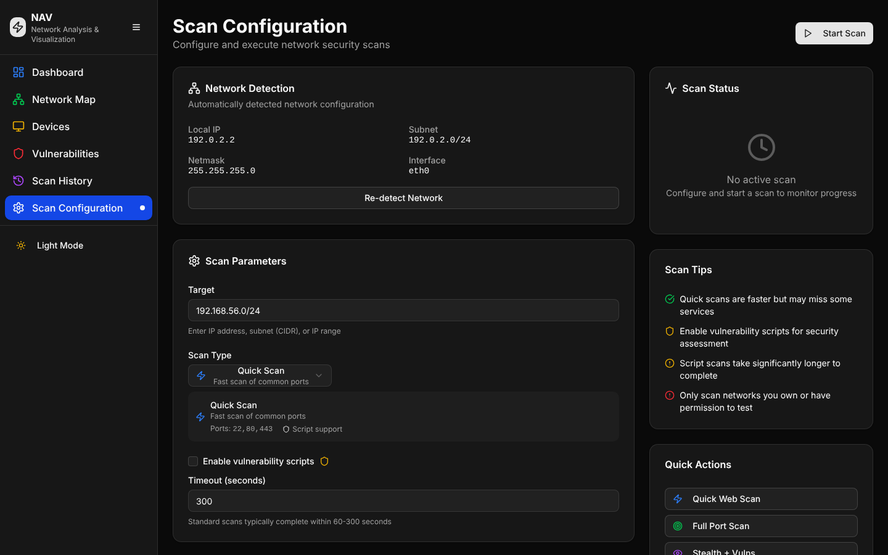

# NAV: Network Analysis & Visualization

[](https://github.com/achraf-lakdim-sec/nav-clean/actions/workflows/ci.yml)

NAV is a web app that maps a local network and shows what is exposed on it. A FastAPI backend drives Nmap, and a React front end turns the results into a device list, an interactive topology map, a vulnerability view and a scan history.

I built it during a summer internship at Huawei (Rabat, 2025) to give network teams a visual alternative to reading raw Nmap output.



## Features

- Detects the local IP address, netmask and subnet of the machine running the API.
- Runs quick, full, custom, aggressive and NSE vulnerability-script scans against a host, a CIDR range or the local subnet.
- Parses Nmap output into hosts, open ports, services and potential vulnerabilities (lines flagged `VULNERABLE` or with a CVE identifier).
- Shows devices on an interactive network map and keeps a local scan history with statistics.

## Architecture

```
React + Vite front end  ──HTTP──►  FastAPI backend  ──argument list──►  nmap
   (frontend/)                       (backend/)                     (subprocess, no shell)
```

The API listens on `127.0.0.1:8000` only, and the front end calls it from the browser.

## Getting started

You need Python 3.10 or later, Node.js 20 or later, and Nmap installed and on your `PATH`.

Backend:

```bash
cd backend
python3 -m venv .venv
source .venv/bin/activate
pip install -r requirements.txt
python3 main.py
```

Front end, in a second terminal:

```bash
cd frontend
npm ci
npm run dev
```

Then open <http://localhost:5173>. Aggressive scans include OS detection, which needs Nmap to run with root privileges.

> Only scan networks you own or are explicitly authorized to test.

## Security

This tool runs Nmap on behalf of whoever can reach its API, so I reviewed it as an attack surface and fixed the following issues.

| Issue | Risk | Fix |
| --- | --- | --- |
| Targets and ports were passed to Nmap without validation | Argument injection: a target such as `--script=...` or `-iL /etc/passwd` is parsed by Nmap as an option, which can lead to file reads or code execution through NSE scripts | Every target must be an IP address, a CIDR range (no larger than a /16) or a hostname, and ports must be numbers or ranges. Anything else is rejected with HTTP 422 ([`backend/validation.py`](backend/validation.py)) |
| CORS allowed every origin | Any website open in the user's browser could call the API and read the scan results | CORS is restricted to the NAV front end and can be configured with `NAV_ALLOWED_ORIGINS` |
| Scans are triggered by `GET` requests | Even without CORS, a malicious page could fire scans through the user's browser (cross-site request forgery) | Requests from unknown origins, or flagged `cross-site` by the browser's fetch metadata, are rejected with HTTP 403 before reaching any endpoint |

Shell injection was never possible, because commands are built as argument lists and run without a shell.

Known limitations: the API has no authentication and is meant for local use only, and the scan history is stored unencrypted, both in `backend/scan_history.json` (excluded from Git) and in the browser's local storage. See [SECURITY.md](SECURITY.md) to report a vulnerability.

## Tests

The security fixes are covered by regression tests that replace Nmap with a stub, so they run anywhere:

```bash
cd backend
pip install -r requirements-dev.txt
pytest -q
```

The suite fails 38 of its checks on the original code and passes on the fixed version. GitHub Actions runs it on every push, together with a production build of the front end.

## Tech stack

Python, FastAPI, Nmap, React, Vite, Tailwind CSS, shadcn/ui, vis-network, GitHub Actions.
